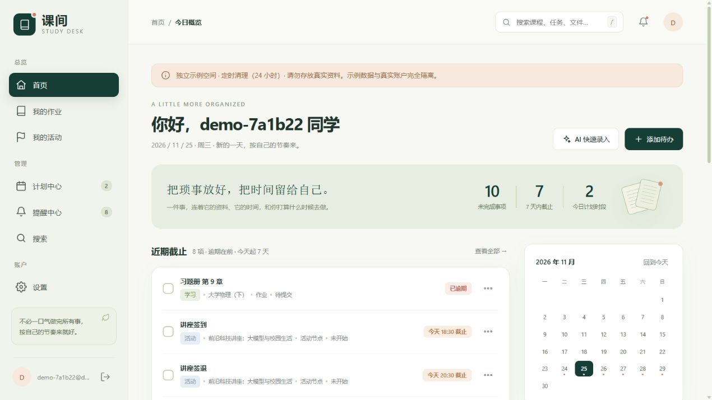
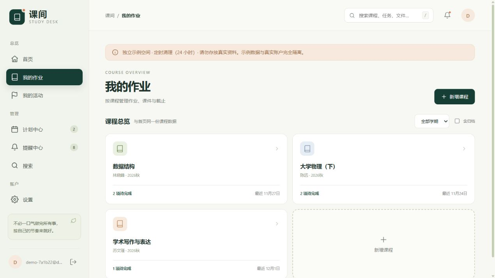
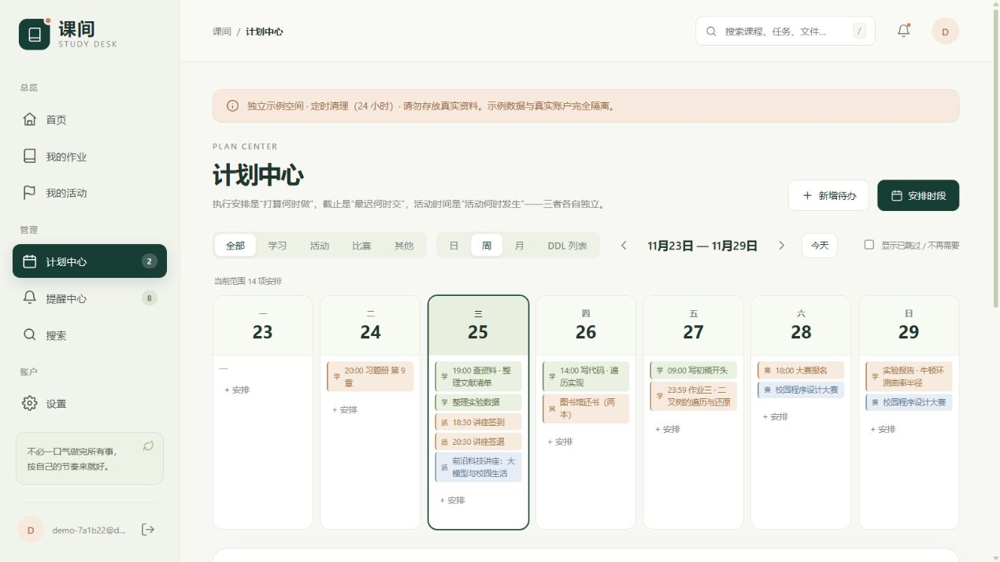

# 课间 · Study Desk

课间是一款面向本科生、研究生的个人学习事务管理工具。老师在群里发了一份作业，同学通常要做三件事：记下什么时候交，把要求和资料收好，再找时间动手。课间把这三件事放进同一条任务记录。从首页点开即将截止的作业，就能找回课件、报告和提交要求，也能看到自己给它留了哪几个晚上。



## 第一次使用

准备 Node.js 18 或更高版本。下载或克隆本仓库，在项目根目录执行：

```sh
node server.js
```

打开 [本机工作台](http://localhost:5173)，点击 **进入隔离示例空间**。里面有数据结构作业、物理实验、校园讲座和程序设计比赛，可以直接体验。示例空间会在 24 小时后清理。要持续记录自己的资料，请从登录页进入个人账户。开发版的登录验证码显示在页面上，适合本机体验。

首次启动时，程序自动创建 `data/`。账户和事务保存在 `data/db.json`，上传的文件保存在 `data/files/`。前端使用原生 JavaScript，后端使用 Node.js 内置模块，无需安装依赖或构建。可用环境变量 `PORT` 更换端口。

## 从一门课开始

在 **我的作业** 中创建课程，填写教师、上课地点和周次。每次收到作业就添加任务，记录要求、截止时间和分工，把课件、实验数据、报告或资料链接放在课程或具体作业下。老师给出成绩后，还可以补录分数和评语。期末复习时，沿课程就能找到这学期的材料。

例如，给「二叉树的遍历与还原」设置周五 23:59 截止，在周四下午安排编写代码，周五留一个时段检查并打包。完成周四的时段只结束这次安排。真正向教学平台提交后，再把作业标记为「已提交」。



## 从一场活动到一次比赛

**我的活动** 按活动归档资料。参加讲座时，可以把海报、报名凭证、签到和签退照片放在同一处。讲座时间记录在活动上，报名截止记录在报名任务上，活动后仍能找回参与凭证。

比赛可以从阶段模板开始，勾选需要的节点，修改名称和截止日期后保存。例如，把一次设计比赛拆成报名、作品制作、作品提交和答辩准备。每个节点可以单独安排时段、记录分工和关联文件。再次打开比赛详情时，可以查看阶段进度并找到最终提交版。

## 计划和截止提醒

**计划中心** 支持日、周、月和 DDL 视图，可筛选学习、活动、比赛和其他事项。课程或活动详情与计划中心读取同一条任务，改一次截止时间即可。DDL 可切换列表或卡片显示。

| 想知道什么 | 在哪里看 |
| --- | --- |
| 今天准备做哪一步？ | 日视图或首页的「今天的计划」，查看安排好的时段 |
| 这周比赛和课程有没有撞期？ | 周视图选「全部」，一起查看执行时段、活动时间和截止事项 |
| 哪份作业快交了？ | 首页「近期截止」或 DDL 视图，点入任务查看要求与附件 |

任务默认从截止前 7 天起每天进入站内提醒范围，也可以自定提前天数、选择具体提醒日、调整逾期提醒或关闭提醒。系统按北京时间处理日期。邮件摘要默认关闭，预设时间为 20:00；当前版本可生成批次记录，实际邮件投递尚未接入。



## 不同专业的文件怎么放

上传时服务端按原始字节保存文件，下载时返回原文件，所以设计稿、CAD 图纸、代码压缩包等都可以作为附件。浏览器内支持预览 JPG、JPEG、PNG、GIF、WebP 和 PDF，其他格式下载后用对应的专业软件打开。一个工程依赖多份源文件或贴图时，可以将整个目录打包为 ZIP，以保留相对路径。

- 单个文件上限 **100 MB**，每个账户总容量 **2 GB**。历史版本也占用容量。
- 同一份材料可以上传新版、保留旧版并标记最终版。已经放在教学平台或网盘的资料，可以直接保存链接。
- 「AI 快速录入」在此版本中使用本地规则从粘贴的通知生成草稿。核对原文、课程和日期后再保存，尤其适合处理一条通知里的多项任务。

## 产品思路与取舍

[MyStudyLife](https://mystudylife.com/tour/) 已将课程、考试、课外活动和任务纳入学生日程。[滴答清单](https://dida365.com/features?language=zh_CN) 提供快速录入、清单、日历和多种提醒。课间选择围绕学生实际交付的东西组织信息：赶作业时找源文件，比赛提交时确认版本，活动结束后找签到证明。这些场景能否节省时间，取决于学生是否愿意在收到材料时顺手归档。

对于只有少量待办的同学，录入课程和搬运附件会增加负担；保存链接可减少重复上传。大型专业工程还受个人容量和传输速度限制。当前数据由运行程序的机器保存，适合个人本机使用。备份时先停止服务，再复制整个 `data/`，以便同时保留任务记录与附件。
